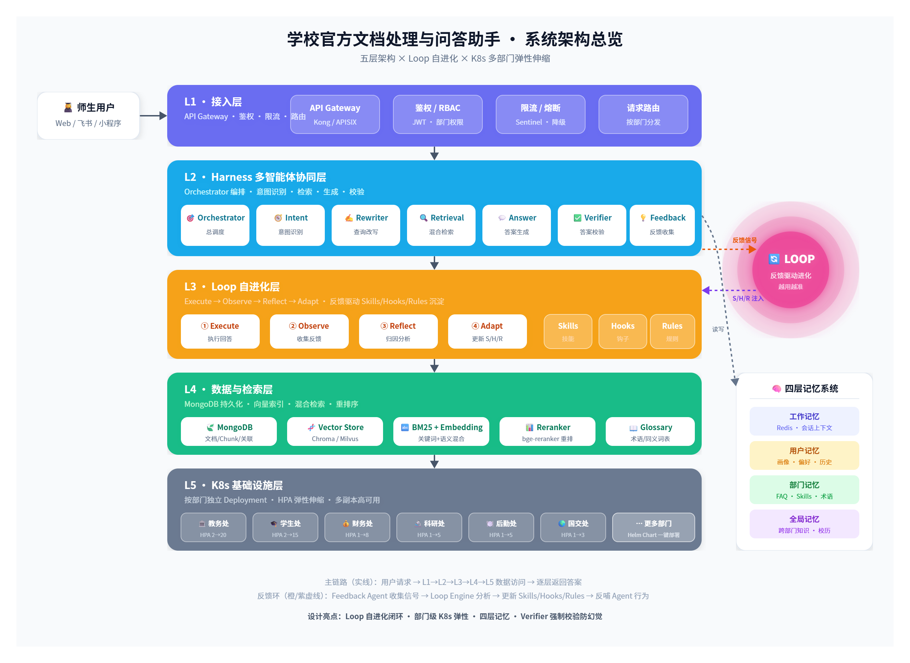

# Wenshu: Governed Multi-Department Policy Assistant

Wenshu is a policy-oriented AI assistant for universities and other organizations with multiple departments, document owners, and policy versions.

It was designed around a simple production requirement:

> An answer is not trustworthy merely because it sounds correct. It must come from the right department, the right document version, and an active, auditable clause.

Wenshu combines:

- grounded hybrid retrieval for exact terms and semantic questions;
- a deterministic Agent Harness around probabilistic model reasoning;
- document lifecycle and version governance;
- evidence verification and safe refusal;
- five separate memory planes with authority and permission controls;
- department-level Agent Services and cross-department orchestration;
- a feedback-to-strategy loop that can replay, canary, monitor, and roll back changes.

This repository is a research and engineering reference implementation. Review authentication, data retention, secret management, document permissions, and operational configuration before using it with real users or institutional data.

## At a glance

| Dimension | Summary |
| --- | --- |
| Primary scenario | Multi-department university policies, procedures, notices, and FAQs |
| Core invariant | Answers must be grounded in active, authorized, auditable clauses |
| Answer path | Intent → Rewrite → Retrieval → Answer → Verify |
| Learning path | Execute → Observe → Reflect → Adapt → Deploy |
| Main services | FastAPI control plane, pi Agent Runtime, Next.js frontend |
| Data services | MongoDB facts, Milvus vectors, Redis state and streams |
| Deployment | Docker Compose locally; Kubernetes and Helm for services |
| Evaluation scale | 1,086 documents · 28,640 clauses · 1,200 questions |
| Documented quality | 93.4% Recall@5 · 96.1% citation correctness · 93.1% overall accuracy |
| Documented safety | 97.3% unsupported-question safe refusal |

## Contents

- [Problem and design goals](#problem-and-design-goals)
- [Capabilities](#capabilities)
- [System architecture](#system-architecture)
- [End-to-end request flow](#end-to-end-request-flow)
- [Document ingestion and trusted RAG](#document-ingestion-and-trusted-rag)
- [Memory architecture](#memory-architecture)
- [Feedback Loop and executable strategies](#feedback-loop-and-executable-strategies)
- [Department isolation and scaling](#department-isolation-and-scaling)
- [Security and safe failure behavior](#security-and-safe-failure-behavior)
- [Technology stack](#technology-stack)
- [Evaluation methodology and results](#evaluation-methodology-and-results)
- [Performance, cost, and bottlenecks](#performance-cost-and-bottlenecks)
- [Repository structure](#repository-structure)
- [Run locally](#run-locally)
- [Testing and verification](#testing-and-verification)
- [Limitations and next steps](#limitations-and-next-steps)
- [License](#license)

## Problem and design goals

The initial prototype followed a conventional pipeline:

```text
Upload documents → split into chunks → vector search → generate an answer
```

That approach was useful for a demo but exposed several problems in a policy setting:

1. **Policy documents have ownership and versions.** A 2022 regulation, a 2025 regulation, and a draft consultation document can be semantically similar but have different authority.
2. **Exact information is difficult for pure vector search.** Week numbers, telephone numbers, clause identifiers, dates, and office names require lexical precision.
3. **Open-ended Agent planning is difficult to govern.** A free-form ReAct Agent may repeat searches, skip retrieval, or answer from model knowledge.
4. **Conversation context can become misleading.** A follow-up such as “What should I do then?” requires reliable entity resolution.
5. **Feedback is often collected but not used.** A thumbs-down event is not an improvement unless it changes a future execution path and the change can be evaluated.
6. **A multi-department system must fail explicitly.** Returning an apparently complete answer after one department timed out is more dangerous than reporting the missing evidence.

Wenshu addresses these issues by separating deterministic governance from probabilistic reasoning:

- the **Python control plane** owns identity, permissions, data boundaries, state transitions, evidence policy, timeouts, rollout, and rollback;
- the **pi Agent Runtime** performs constrained model-backed tasks such as intent detection, query rewriting, answer generation, verification, and bad-case attribution;
- the **data plane** separates authoritative facts from rebuildable retrieval indexes and non-authoritative memories.

## Capabilities

### Document lifecycle and governance

- Upload and parse PDF and Word documents.
- Clean extracted text and detect document metadata.
- Split documents at semantic and clause boundaries.
- Compute a source hash for deduplication.
- Track document status as **pending**, **active**, or **archived**.
- Maintain document versions and **supersedes** relationships.
- Store source, department, version, and clause metadata.
- Keep the previous active version available until the replacement is fully ready.
- Compensate for partial failures by recording inserted MongoDB and vector-store identifiers.
- Detect possible conflicts between documents and departments.
- Require department ownership checks for document management.

### Query understanding

- Classify the user intent.
- Route a question to one or more departments.
- Expand terminology and aliases.
- Resolve conversational references using confirmed entities from working memory.
- Generate multiple retrieval queries for ambiguous or underspecified questions.
- Preserve the original user wording separately from rewritten queries.
- Apply permission and department filters before evidence enters the answer context.

### Trusted hybrid retrieval

- Use BM25 for names, identifiers, dates, telephone numbers, clause numbers, and exact phrases.
- Use dense vector retrieval for semantic variation and paraphrases.
- Fuse ranked lists with Reciprocal Rank Fusion (RRF).
- Apply an optional cross-encoder reranker.
- Rehydrate complete source clauses from MongoDB after candidate retrieval.
- Validate document status and department ownership against the authoritative fact plane.
- Filter candidates by similarity and evidence rules.
- Attach source markers such as [Source 1] to generated answers.
- Keep vector search as a candidate index rather than the source of truth.

Default retrieval settings used in the documented evaluation path:

```text
BM25 candidates:       top 20
Vector candidates:     top 40
Fusion:                 RRF, k = 60
Final stage:            reranking + active-status validation + threshold filtering
```

### Controlled Agent Harness

The online answer path is a fixed DAG:

```text
Intent → Rewrite → Retrieval → Answer → Verify
```

The Harness provides:

- typed input/output contracts between stages;
- per-stage timeout budgets;
- controlled tool access;
- traceable state transitions;
- verifier-directed retries;
- maximum retry limits;
- explicit safe fallbacks;
- replayable execution traces;
- rollout and rollback hooks.

The model can reason inside an allowed stage, but it cannot bypass permission checks, skip the fact-retrieval boundary, publish a strategy, or execute arbitrary tools.

### Evidence verification

The Verifier checks:

- whether every cited clause exists;
- whether each cited document is still active;
- whether the answer's claims are supported by the cited evidence;
- whether an archived or pending version was used;
- whether the response should be refused or rewritten;
- whether a cross-department result clearly states missing departments.

If verification fails, the Answer stage is retried up to two times. If it still fails, Wenshu returns relevant source text and explicitly states that the available evidence is insufficient instead of inventing a conclusion.

### Five-plane memory architecture

Wenshu deliberately avoids putting every form of “memory” into one vector database:

1. **Working memory**
   Recent messages, confirmed entities, current department, and short-lived conversational state. Redis-backed, with a documented 30-minute session TTL.

2. **Episodic memory**
   Append-only interaction events and conversation summaries stored in MongoDB.

3. **User semantic memory**
   Low-sensitivity preferences that are stored only after explicit user consent and can be inspected or deleted.

4. **Organizational knowledge memory**
   Reviewed FAQs and cross-department conclusions. Every item must reference a document ID, chunk ID, and version; it is revalidated against the active source before use.

5. **Procedural memory**
   Skills, Hooks, Rules, experiment assignments, and rollout records. Procedural memory changes execution parameters, not official facts, and is never treated as evidence.

MemoryContextBuilder assembles context in this order:

```text
permission filtering
→ freshness and retention filtering
→ authority ranking
→ character/token budget trimming
→ injection into Intent, Rewrite, and Answer
```

The authority order is:

```text
active official document
> reviewed organizational knowledge
> explicit user statement
> conversation summary
> model-generated hypothesis
```

### Feedback Loop and executable strategies

Wenshu implements:

```text
Execute → Observe → Reflect → Adapt → Deploy
```

- **Execute** records the normal request, evidence, decisions, and outcome in a trace.
- **Observe** collects explicit signals such as likes, dislikes, and corrections, plus implicit signals such as follow-up questions, unsupported answers, refusals, and timeouts.
- **Reflect** attributes bad cases to retrieval, intent, generation, or knowledge_gap.
- **Adapt** creates candidate Skills, Hooks, Rules, or knowledge-gap work items.
- **Deploy** replays candidates, assigns stable treatment/control buckets, monitors metrics, and rolls back degraded strategies.

Feedback is processed asynchronously:

- Redis Stream carries feedback and Loop events.
- A worker consumes messages with consumer groups and ACK semantics.
- MongoDB async_jobs stores queued, running, completed, and failed states plus stage progress.
- pi performs probabilistic attribution and candidate generation.
- The deterministic engine validates schemas, replays historical traces, controls exposure, and decides whether to publish or roll back.

#### Skill, Hook, and Rule

- **Skill:** a complete strategy package for a query family. It can expand query terms, change top-k, switch an answer template, or inject a domain constraint.
- **Hook:** a lightweight intervention before or after a particular stage, such as forcing a terminology expansion after Rewrite.
- **Rule:** a hard constraint, such as always appending a department contact for a specific policy category.

A documented extreme-weather Skill changes the execution path by:

- increasing default retrieval top-k from 5 to 8;
- expanding terms such as “warning”, “avoidance”, and “emergency telephone”;
- switching to a risk → action → help answer template;
- recording the treatment assignment and changed execution parameters.

The strategy is considered behaviorally active only when the trace shows that it changed execution. A log entry alone is not treated as evidence of improvement.

#### Knowledge-gap mining

A knowledge gap is different from a poor retrieval strategy: it means the organization may not have supplied the relevant policy at all.

Wenshu can:

- collect unsupported questions and low-feedback examples;
- embed and cluster similar questions;
- use a minimum cluster size to remove noise;
- create a knowledge-gap work item with representative questions;
- suggest a responsible department for document completion.

## System architecture

Wenshu is organized into five layers:

```text
┌─────────────────────────────────────────────────────────┐
│ 1. Access layer                                         │
│    FastAPI REST API, authentication, rate limiting      │
├─────────────────────────────────────────────────────────┤
│ 2. Harness layer                                        │
│    fixed DAG, budgets, retries, verification, rollback  │
├─────────────────────────────────────────────────────────┤
│ 3. Capability layer                                     │
│    hybrid retrieval, memory planes, Skills, Loop        │
├─────────────────────────────────────────────────────────┤
│ 4. Data layer                                           │
│    MongoDB facts, Milvus vectors, Redis state and flow  │
├─────────────────────────────────────────────────────────┤
│ 5. Runtime layer                                        │
│    department services, Kubernetes, Prometheus, HPA     │
└─────────────────────────────────────────────────────────┘
```



The most important boundary is control ownership:

- the access and data layers provide infrastructure;
- the capability layer provides tools and policies;
- the Harness decides which step is allowed next;
- the model performs bounded reasoning only where it is authorized.

### Online request sequence

1. Authenticate the request and load the user's role and department permissions.
2. Build a bounded memory context.
3. Classify intent and select one or more departments.
4. Rewrite the query using terminology and confirmed conversation entities.
5. Retrieve from BM25 and vector search in parallel.
6. Fuse and rerank candidates.
7. Rehydrate complete active clauses from MongoDB.
8. Generate an answer with source markers.
9. Verify citations, active status, and claim support.
10. Retry, refuse, or return source text according to the verification result.
11. Persist the trace, feedback context, and episodic memory.

### Why a fixed DAG instead of an unrestricted ReAct loop?

An unrestricted ReAct Agent is useful for exploration, but the policy-answering path has a stable shape and high error cost. In early experiments, free-form planning could:

- repeat nearly identical retrieval queries;
- spend additional tokens without improving recall;
- occasionally skip retrieval and answer from model knowledge.

The fixed DAG sacrifices some flexibility in exchange for:

- predictable latency;
- explicit failure handling;
- replayable traces;
- testable contracts;
- controlled evidence access;
- bounded retries.

For future tasks that genuinely require multi-step dependencies, the safer extension is a constrained sub-loop inside the DAG rather than unrestricted control over the entire pipeline.

## Document ingestion and trusted RAG

The ingestion state machine is designed to avoid an “active version gap”:

```text
upload
  → hash and deduplicate
  → parse and clean
  → semantic/clause chunk
  → embed and index
  → write fact records
  → mark new version ready/active
  → archive superseded version
```

The previous active document is not archived until the replacement's chunks and fact records are ready. If indexing or persistence fails, the replacement remains pending and the old active version remains available.

Old or invalid documents are blocked by three checks:

1. vector retrieval filters for active status and department scope;
2. MongoDB rehydration checks the authoritative document status again;
3. Verifier rejects any final citation that points to a non-active document.

This double-plane design separates:

- **fact plane:** authoritative, auditable, versioned MongoDB records;
- **candidate plane:** rebuildable Milvus indexes used for fast retrieval.

That separation also makes it possible to replace the embedding model and rebuild the candidate index without rewriting authoritative policy data.

## Department isolation and scaling

Each department can run as an independent Agent Service with a fixed DEPT_ID. All internal retrieval paths enforce the department scope.

A Global Orchestrator:

- identifies the departments involved in a question;
- invokes department services in parallel;
- applies independent timeouts;
- merges returned evidence;
- generates a unified answer;
- reports departments that timed out or failed.

The system supports partial success. If the finance service is unavailable during a question involving finance and academic affairs, the answer can use the available academic evidence but must explicitly state that the finance result was not retrieved.

### Kubernetes and autoscaling

The deployment layer includes:

- Kubernetes manifests;
- Helm templates;
- separate backend, pi-agent, loop-engine, and department-agent deployments;
- MongoDB and Redis resources;
- Prometheus monitoring;
- Prometheus Adapter;
- ingress and persistent upload storage;
- HPA configuration.

The primary autoscaling signal is:

```text
wenshu_dept_agent_inflight
```

This counts requests currently being processed by each Pod. It is more appropriate than CPU for an I/O-heavy service that spends much of its time waiting on external models and vector/database services.

## Security and safe failure behavior

### Authentication and authorization

- User tokens are HMAC-signed and contain user identity, roles, department permissions, and iat/exp.
- Ordinary users can ask questions and submit feedback.
- Department administrators can manage documents and review knowledge for their department.
- System administrators can manage Skills, rollout settings, and global configuration.
- Resource ownership is checked in addition to role checks.
- Internal service calls require X-Internal-Token.
- Internal authentication is fail-closed: missing or invalid configuration rejects the request.

### Prompt-injection resistance

The design does not rely only on a prompt instruction such as “ignore malicious instructions.” It uses structural controls:

- tools are allow-listed;
- tool parameters are schema-validated;
- the model cannot execute arbitrary code or access arbitrary files/network resources;
- retrieved documents are explicitly delimited as reference material;
- evidence is checked by the Verifier;
- unsupported claims do not pass the final evidence boundary.

### Safe degradation matrix

| Failure | Fallback | User-visible behavior |
| --- | --- | --- |
| Reranker unavailable | Use RRF order and lexical heuristics | Lower ranking quality, but still grounded |
| Generation timeout | Return retrieved source clauses | Explicitly says no summary was generated |
| Milvus unavailable | Use BM25 only | Semantic recall may decrease |
| Redis unavailable | Disable working memory | Follow-up references may need clarification |
| Department timeout | Merge partial results | Missing department is disclosed |
| Verifier fails twice | Stop rewriting and return source text | Explicitly states that evidence is insufficient |
| Model service unavailable | Serve governed retrieval | Searchable active clauses remain available |

The design principle is:

> Degrade capability, not trust.

The system should provide fewer capabilities before it provides an unsupported policy answer.

## Technology stack

### Application and control plane

| Area | Technology | Role |
| --- | --- | --- |
| API and control plane | Python, FastAPI | REST API, authentication, orchestration, governance |
| Async data access | Motor | MongoDB async integration |
| Agent Harness | Python stateful DAG | Stage contracts, budgets, retries, verification, rollback |
| Agent runtime | pi Agent Runtime, pi-agent-core, pi-ai | Constrained model-backed reasoning and tool calls |
| Frontend | Next.js 15, React 19, TypeScript | Chat UI, administration, feedback, Loop monitoring |

### Retrieval and models

| Area | Technology | Role |
| --- | --- | --- |
| Lexical retrieval | BM25 | Exact terms, identifiers, dates, and names |
| Dense retrieval | Milvus | Semantic candidate recall |
| Rank fusion | RRF | Rank-based combination of retrieval sources |
| Reranking | BAAI/bge-reranker-v2-m3 | Cross-encoder candidate ordering |
| Chat model | DeepSeek-compatible API | Intent, rewrite, answer, verify, and reflection tasks |
| Embeddings | text-embedding-3-large or configured provider | Vector representation |
| Query strategy | Terminology and entity expansion | Alias handling and multi-query retrieval |

### Storage, messaging, and operations

| Area | Technology | Role |
| --- | --- | --- |
| Fact store | MongoDB | Documents, clauses, versions, jobs, traces, memory events |
| Working state | Redis | Session memory, rate limiting, stream transport |
| Async events | Redis Stream | Consumer groups, ACK, pending inspection, retries |
| Containers | Docker, Docker Compose | Local full-stack environment |
| Orchestration | Kubernetes, Helm | Deployment, isolation, scaling |
| Metrics | Prometheus | Runtime and business metrics |
| Metric adapter | Prometheus Adapter | External metric for HPA |
| Load testing | k6 and custom analysis scripts | Department-agent throughput and latency tests |
| Testing | pytest, TypeScript build checks, browser smoke scripts | Unit, integration, build, and UI validation |

## Evaluation methodology and results

The documented evaluation used:

- **1,086** policy documents;
- **28,640** semantic clauses/chunks;
- **1,200** stratified evaluation questions;
- **960** questions for iteration and strategy tuning;
- **240** frozen questions for final acceptance.

The evaluation set was stratified by department, intent, difficulty, cross-department questions, and safe-refusal cases.

The table below records the project evaluation results documented in the project specification. The baseline was a simple vector-RAG prototype.

| Metric | Baseline | Final |
| --- | ---: | ---: |
| Recall@5, chunk level | 84.7% | **93.4%** |
| MRR | 0.741 | **0.862** |
| Citation correctness | 88.3% | **96.1%** |
| Department routing accuracy | 86.5% | **94.2%** |
| Answer key-point completeness | 80.2% | **92.4%** |
| Unsupported-question safe refusal | 71.5% | **97.3%** |
| Overall answer accuracy | 82.6% | **93.1%** |

The documented attribution of the overall accuracy gain was:

- **+7.2 percentage points** from hybrid retrieval and fact governance;
- **+3.3 percentage points** from two rounds of Skill canary iteration;
- **+10.5 percentage points** in total.

### Latency results

| Query type | P50 | P95 |
| --- | ---: | ---: |
| Single-department question | 1.8 s | 3.6 s |
| Cross-department question | 2.7 s | 5.4 s |

### Load-test results

A department-agent comparison from 1 to 20 Pods reported:

| Metric | 1 Pod | 20 Pods |
| --- | ---: | ---: |
| Effective throughput | 8.7 req/s | 57.9 req/s |
| P95 latency | 7.6 s | 2.9 s |
| Error rate | 2.4% | 0.7% |

This is approximately **6.7× the single-Pod throughput**, not a linear 20× improvement. The documented bottlenecks were:

- shared external-model TPM/RPM quotas;
- tail latency from the slowest department in a cross-department request;
- shared MongoDB and Redis connection pools.

These numbers are project benchmark results from the supplied project documentation; they were not regenerated during this README rewrite.

## Performance, cost, and bottlenecks

### Cost profile

The documented estimate under the stated model pricing was:

- approximately **3.1K input tokens** and **580 output tokens** per single question;
- approximately **¥0.016** per single-department answer;
- approximately **¥0.031** per cross-department answer;
- approximately **28%** cost reduction after context and model-selection optimizations.

The optimizations were:

1. trim memory by authority and character budget;
2. deduplicate overlapping evidence before prompt assembly;
3. use a smaller model for short Intent tasks.

### Current bottlenecks

- External model generation occupies more than half of answer-path P95 latency.
- Tables and appendices remain harder to chunk and retrieve reliably.
- Cross-department conflict resolution can currently present both policies without deciding priority.
- BM25 indexes are memory-resident and can become inconsistent across multiple Pods.
- Ingestion cleanup currently relies on application-level compensation rather than a full Outbox/Saga workflow.

## Repository structure

```text
.
├── backend/                 FastAPI control plane, retrieval, memory, Loop, tests
│   ├── app/harness/         Fixed DAG and Agent Harness
│   ├── app/pipeline/        Parsing, cleaning, metadata, chunking, indexing
│   ├── app/retrieval/       BM25, vector search, fusion, reranking
│   ├── app/memory/          Five-plane memory implementation
│   ├── app/loop/            Feedback Loop, Skills, Hooks, Rules
│   ├── app/review/          Human-review and evaluation workflow
│   ├── scripts/             Seeding, ingestion, workers, doctor, evaluation
│   └── tests/               Backend unit and integration tests
├── services/pi-agent/       TypeScript pi runtime service
├── web/                     Next.js frontend and browser smoke scripts
├── deploy/                  Kubernetes manifests and Helm chart
├── docs/                    Architecture, API, deployment, and Loop docs
├── design_files/images/     Architecture and deployment diagrams
├── loadtest/                k6 load test and result analysis
├── docker-compose.yml       Local multi-service environment
├── .env.example             Safe configuration template
└── .gitignore
```

Potentially sensitive source documents under department_files/ are intentionally kept local and ignored. Add only documents that you are authorized to publish or process.

## Run locally

### Prerequisites

- Docker Desktop with Compose for the full stack;
- Python 3.9+ for standalone backend development, with Python 3.11 recommended;
- Node.js 22.19+ for the pi service and frontend;
- valid model-provider credentials for model-backed features.

### Full stack with Docker

```bash
git clone https://github.com/lzy1390407584-byte/wenshu-project.git
cd wenshu-project
cp .env.example .env
# Edit .env with your own credentials and strong local secrets.
docker compose up --build -d
docker compose ps
```

Default endpoints:

| Service | Address |
| --- | --- |
| Web UI | http://localhost:8080 |
| Backend API/OpenAPI | http://localhost:8000/docs |
| pi-agent health | http://localhost:8100/health |
| MongoDB | localhost:27017 |
| Redis | localhost:6379 |

Initialize the local database and ingest approved local documents:

```bash
docker compose exec backend python -m scripts.seed_data
docker compose exec backend python -m scripts.ingest_department_files --base /app/department_files
```

### Standalone development

Backend:

```bash
cd backend
python -m venv .venv
# Windows PowerShell:
# .\\.venv\\Scripts\\Activate.ps1
# macOS/Linux:
# source .venv/bin/activate
pip install -r requirements.txt
uvicorn app.main:app --reload --port 8000
```

pi-agent:

```bash
cd services/pi-agent
npm install
npm run dev
```

Frontend:

```bash
cd web
npm install
npm run dev
```

For local development without MongoDB and Redis, configure STORAGE_MODE=memory where supported. Do not use development secrets or demo users in a shared or public deployment.

### Configuration safety

- Copy .env.example to .env; never commit .env.
- Replace AUTH_SECRET, INTERNAL_API_TOKEN, MongoDB credentials, and Redis credentials.
- Set SEED_DEMO_USERS=false outside local development.
- Restrict CORS_ORIGINS to the actual frontend origin.
- Keep Kubernetes secret values outside Git; use deploy/k8s/secrets.yaml.example only as a template.
- Review document permissions and retention before loading institutional files.

## Testing and verification

### Backend tests

```bash
cd backend
pytest -q
```

The test suite covers authentication, storage, BM25, retrieval, chunking, document versions, memory architecture, department Agents, the Harness pipeline, asynchronous jobs, Loop behavior, review workflow, and pi runtime integration.

### Build checks

```bash
cd web
npm run build

cd ../services/pi-agent
npm run build
```

### Model connectivity checks

```bash
cd backend
python -m scripts.doctor
```

### RAG evaluation

```bash
cd backend
python -m scripts.evaluate_rag
```

### Load testing

See loadtest/README.md for the department-agent k6 scenario and result comparison script.

The performance and quality figures in the evaluation section are the documented project results. Run the commands above to reproduce or update them in your own environment.

## Limitations and next steps

The documented next steps are ordered by correctness and trustworthiness:

1. Move BM25 to Elasticsearch/OpenSearch to remove the multi-Pod in-memory index consistency debt.
2. Add structured parsing for tables and appendices.
3. Expand the evaluation set to department-level tens-of-thousands scale and add a second annotator.
4. Add semantic caching and further cost optimization.
5. Introduce stronger Outbox/Saga reconciliation for ingestion and index updates.
6. Add explicit conflict-priority policies for cross-department regulations.
7. For multi-tenant deployment, isolate tenant_id + dept_id in data, vector collections, Skills, Rules, evaluation, and quota accounting.

## License

No license file is currently included. Add an explicit license before accepting external contributions or redistributing this project.
